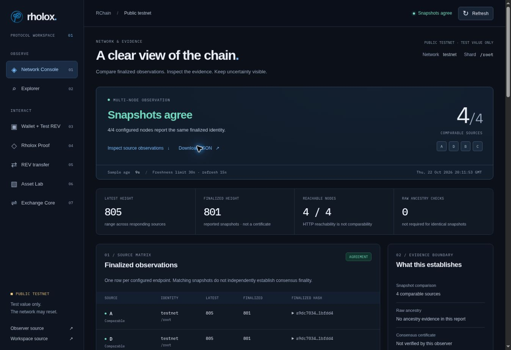

# Evidence console review

Production-build browser review, 22 October 2026. Screenshots show sampled public-testnet data; heights and availability can change.

[Phone viewport](evidence/console-phone.jpg)

## Verified behavior

| Check | Result and scope |
|---|---|
| Desktop layout | Production assets loaded with the restrictive content policy; logo, source rows and real observer data rendered |
| Phone/tablet layout | 375px and 768px iframe viewport checks; no document-level horizontal overflow; wide source table scrolls within its own labeled region |
| Key prerequisites | Proof and transfer anchors remain navigable before wallet creation |
| Session wallet | Generated an unfunded test identity; balance read returned zero; navigation retained session state; the private key was not revealed or exported |
| Explorer | Recent-height lookup loaded block details from the public node, including justifications, bonds and rejected-deploy count |
| Copy | Reference-hash copy displayed success feedback |
| Export | Browser downloaded the validated observer JSON without wallet state |
| Protocol/transport policy | 57 deterministic checks cover malformed/inconsistent reports, sampling-window and clock/freshness boundaries, coverage, lag/conflict, stalled bodies, cancellation, body limits, nested direct-node schemas and requested-block identity matching |
| Existing operation models | AMM arithmetic sweep, actor model and recovery source guards pass; those tests retain their documented execution limits |

No funding, signed deploy, transfer, asset creation or exchange mutation was performed for this review. Production build verification does not establish that a deployment to the existing custom domain succeeded. Use the PR's CI artifacts and hosting deployment result as separate evidence.

## Display policy

- Full-coverage positive state requires at least two fresh comparable configured endpoints.
- Exact matching snapshots do not constitute a consensus certificate; raw signature checks apply to traversed ancestry evidence in the separate observer service.
- A singleton, missing source, partial identity, stale/future-clock sample, failed refresh or unresolved path cannot produce a full-coverage positive state.
- A retained snapshot stays inspectable after failure and is explicitly stale. Snapshot freshness does not establish finality progress.
- Same-height majority is a count finding in a conflict, not a stake-weighted quorum.

The existing transaction/contract assurance and isolated-node release gates remain documented in `REVIEW.md` and `EXCHANGE-MECHANICS.md`. This UI change does not merge or replace the separate unmerged assurance branches.
